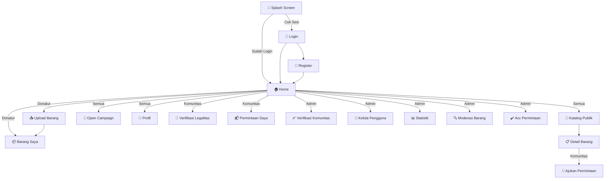
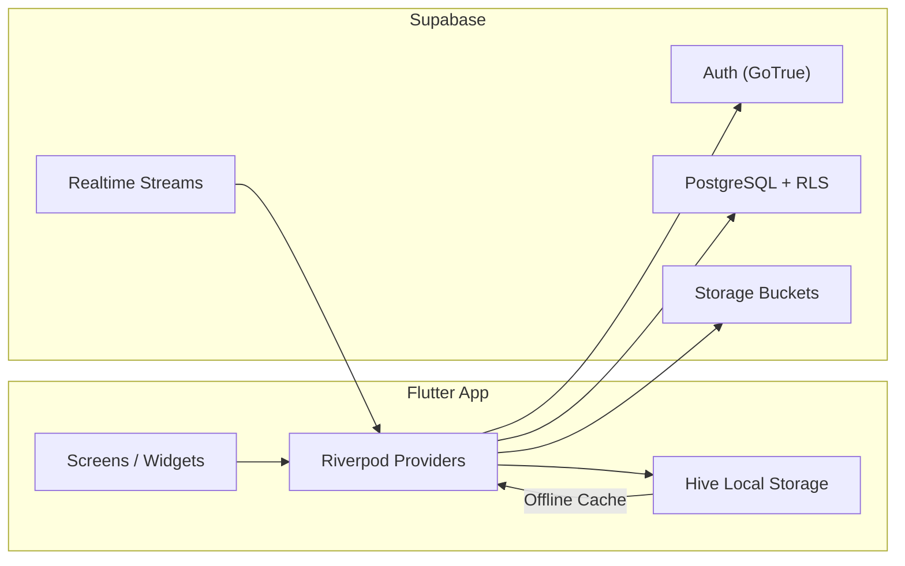

# CareCycle — Design System & Figma Blueprint

> **Versi**: 1.0 &nbsp;|&nbsp; **Terakhir diperbarui**: 16 Oktober 2026
> Dokumen ini menghubungkan setiap elemen desain dengan file kode sumber Flutter yang mengimplementasikannya.

---

## 1. Design Tokens (Kode ↔ Figma)

### 1.1 Color Palette

| Token | Hex | Preview | File Sumber |
|-------|-----|---------|-------------|
| **Primary** | `#047857` | 🟩 | [`app_colors.dart`](file:///d:/KULIAH%20BUD/Ssemester%203/Pemrograman%20Mobile/carecycle/lib/core/constants/app_colors.dart) L5 |
| Primary Light | `#10B981` | 🟩 | `app_colors.dart` L6 |
| Primary Dark | `#065F46` | 🟩 | `app_colors.dart` L7 |
| Background Light | `#F0FDF4` | ⬜ | `app_colors.dart` L10 |
| Surface Light | `#FFFFFF` | ⬜ | `app_colors.dart` L11 |
| Background Dark | `#0F172A` | ⬛ | `app_colors.dart` L15 |
| Surface Dark | `#1E293B` | ⬛ | `app_colors.dart` L16 |
| Text Primary Light | `#1F2937` | ⬛ | `app_colors.dart` L20 |
| Text Secondary Light | `#6B7280` | 🔲 | `app_colors.dart` L21 |
| Text Primary Dark | `#F9FAFB` | ⬜ | `app_colors.dart` L23 |
| Text Secondary Dark | `#9CA3AF` | 🔲 | `app_colors.dart` L24 |
| Success | `#22C55E` | 🟢 | `app_colors.dart` L27 |
| Warning | `#F59E0B` | 🟡 | `app_colors.dart` L28 |
| Error | `#EF4444` | 🔴 | `app_colors.dart` L29 |
| Info | `#3B82F6` | 🔵 | `app_colors.dart` L30 |

#### Gamification Colors
| Level | Hex | Syarat |
|-------|-----|--------|
| Starter | `#10B981` 🟩 | 0–4 barang |
| Hero | `#3B82F6` 🔵 | 5–14 barang |
| Savior | `#F59E0B` 🟡 | 15+ barang |

> File: [`gamification_calculator.dart`](file:///d:/KULIAH%20BUD/Ssemester%203/Pemrograman%20Mobile/carecycle/lib/core/utils/gamification_calculator.dart)

### 1.2 Typography

| Style | Size | Weight | Usage |
|-------|------|--------|-------|
| Heading XXL | 32px | Bold | Splash title |
| Heading XL | 24px | Bold | Screen titles |
| Heading LG | 18px | SemiBold | Section headers |
| Body MD | 16px | Regular | Body text |
| Body SM | 14px | Regular | Secondary text |
| Caption XS | 12px | Regular | Badges, timestamps |

> File: [`app_sizes.dart`](file:///d:/KULIAH%20BUD/Ssemester%203/Pemrograman%20Mobile/carecycle/lib/core/constants/app_sizes.dart)

### 1.3 Spacing & Radius

| Token | Value | Usage |
|-------|-------|-------|
| `xs` | 4px | Tight gaps |
| `sm` | 8px | Chip padding, small gaps |
| `md` | 16px | Card padding, section gaps |
| `lg` | 24px | Screen padding |
| `xl` | 32px | Large sections |
| `xxl` | 48px | Hero spacing |
| `radiusSm` | 8px | Chips, small buttons |
| `radiusMd` | 12px | Cards, inputs |
| `radiusLg` | 16px | Dialogs, large cards |
| `radiusXl` | 24px | Bottom sheets |
| `radiusFull` | 999px | Avatars, pills |

### 1.4 Component Heights

| Component | Height |
|-----------|--------|
| Button | 48px |
| Text Input | 52px |
| AppBar | 56px |
| Bottom Nav | 64px |

---

## 2. Reusable Components

### 2.1 AppButton
> File: [`app_button.dart`](file:///d:/KULIAH%20BUD/Ssemester%203/Pemrograman%20Mobile/carecycle/lib/core/widgets/app_button.dart)

| Variant | Style | Usage |
|---------|-------|-------|
| **Primary** | Filled emerald `#047857`, white text, h=48px, radius=12px | Main CTAs |
| **Outlined** | Border emerald, emerald text, transparent bg | Secondary actions |
| **Loading** | Shows `CircularProgressIndicator` 20x20, disabled | Async operations |
| **With Icon** | Icon + label, same styles | Upload, camera, etc. |

### 2.2 AppScaffold
> File: [`app_scaffold.dart`](file:///d:/KULIAH%20BUD/Ssemester%203/Pemrograman%20Mobile/carecycle/lib/core/widgets/app_scaffold.dart)

- Wraps every screen
- **Offline Banner**: Amber background, WiFi-off icon, "Anda sedang offline"
- Auto-shows via `connectivityProvider`

---

## 3. Screen Mapping (17 Layar)

### Screen Flow Diagram

---

### 3.1 Splash Screen
> Route: `/` &nbsp;|&nbsp; File: [`splash_screen.dart`](file:///d:/KULIAH%20BUD/Ssemester%203/Pemrograman%20Mobile/carecycle/lib/features/auth/presentation/screens/splash_screen.dart)

| Elemen | Spesifikasi |
|--------|-------------|
| Background | Full `#047857` (Primary) |
| Logo | Container putih bulat (80x80), shadow, ikon `Icons.recycling` emerald |
| Animasi | FadeTransition + ScaleTransition (1.5s, Curves.elasticOut) |
| Title | "CareCycle" — 32px, Bold, White |
| Tagline | "Berbagi Kebaikan, Hidupkan Kembali" — 14px, White 70% |
| Auto-nav | 2s delay → cek `HiveService.isLoggedIn()` → `/home` atau `/login` |

---

### 3.2 Login Screen
> Route: `/login` &nbsp;|&nbsp; File: [`login_screen.dart`](file:///d:/KULIAH%20BUD/Ssemester%203/Pemrograman%20Mobile/carecycle/lib/features/auth/presentation/screens/login_screen.dart)

| Elemen | Spesifikasi |
|--------|-------------|
| Header | Ikon recycling + "CareCycle" + tagline |
| Email Input | Prefix `Icons.email_outlined`, validator regex, h=52px |
| Password Input | Prefix `Icons.lock_outline`, suffix toggle `Icons.visibility` |
| Button Masuk | `AppButton` primary, full width |
| Link Daftar | "Belum punya akun? Daftar" → push `/register` |

---

### 3.3 Register Screen
> Route: `/register` &nbsp;|&nbsp; File: [`register_screen.dart`](file:///d:/KULIAH%20BUD/Ssemester%203/Pemrograman%20Mobile/carecycle/lib/features/auth/presentation/screens/register_screen.dart)

| Elemen | Spesifikasi |
|--------|-------------|
| AppBar | "Buat Akun Baru" + back arrow |
| Role Cards | 2 cards side-by-side: **Donatur** (`Icons.volunteer_activism`) & **Komunitas** (`Icons.groups`) |
| Selected State | Border 2px `#047857`, bg `#ECFDF5` (swatch 50) |
| Conditional Field | "Nama Organisasi" — muncul jika role = komunitas |
| Fields | Nama Lengkap, Email, Password (min 6), Konfirmasi Password |
| Button | "Daftar" `AppButton` primary |

---

### 3.4 Home Screen (Adaptif per Role)
> Route: `/home` &nbsp;|&nbsp; File: [`home_screen.dart`](file:///d:/KULIAH%20BUD/Ssemester%203/Pemrograman%20Mobile/carecycle/lib/features/auth/presentation/screens/home_screen.dart)

#### Elemen Umum
| Elemen | Spesifikasi |
|--------|-------------|
| AppBar | "CareCycle" + profile icon (→ `/profile`) + logout icon (konfirmasi dialog) |
| Welcome Card | Avatar inisial (lingkaran 48px) + "Halo, [Nama] 👋" + role badge chip |

#### Donatur Home
| Elemen | Spesifikasi |
|--------|-------------|
| Care Points Card | Gradient `#065F46` → `#047857`, ikon eco, "[X] Care Points", level badge |
| Menu Grid 2×3 | Unggah Donasi, Barang Saya, Katalog Publik, Open Campaign, Dampak & Sertifikat, Panduan Donasi |

#### Komunitas Home
| Elemen | Spesifikasi |
|--------|-------------|
| Verification Banner | Orange/amber jika pending, merah jika ditolak, hijau jika verified |
| Guard Dialog | Muncul saat tekan menu terkunci jika belum verified |
| Menu Grid 2×3 | Permintaan Saya, Open Campaign 🔒, Ajukan Permintaan 🔒, Katalog Publik, Profil & Legalitas |

#### Admin Home
| Elemen | Spesifikasi |
|--------|-------------|
| Admin Banner | Panel shield icon, "Panel Administrator" |
| Menu Grid 2×4 | Verifikasi Komunitas, Acc Permintaan, Kelola Pengguna, Statistik Platform, Moderasi Barang, Semua Kampanye, Profil Admin |

---

### 3.5 Katalog Publik
> Route: `/catalog` &nbsp;|&nbsp; File: [`catalog_screen.dart`](file:///d:/KULIAH%20BUD/Ssemester%203/Pemrograman%20Mobile/carecycle/lib/features/items/presentation/screens/catalog_screen.dart)

| Elemen | Spesifikasi |
|--------|-------------|
| Search Bar | Prefix search icon, hint "Cari barang atau lokasi..." |
| Category Chips | Horizontal scroll: Semua, Pakaian, Buku, Elektronik, Alat Sekolah, Lainnya |
| Offline Banner | Amber banner "Data dari cache lokal" jika offline |
| Item Grid | 2 kolom, card: foto + kategori label + status badge + judul (2 line) + kondisi chip + lokasi |
| Item Card | radius=12px, shadow subtle, tap → `/items/:id` |

---

### 3.6 Detail Barang
> Route: `/items/:id` &nbsp;|&nbsp; File: [`item_detail_screen.dart`](file:///d:/KULIAH%20BUD/Ssemester%203/Pemrograman%20Mobile/carecycle/lib/features/items/presentation/screens/item_detail_screen.dart)

| Elemen | Spesifikasi |
|--------|-------------|
| Header Image | Full width, `CachedNetworkImage` |
| Status Banner | Realtime (Supabase stream): Tersedia=hijau, Diajukan=biru, Diproses=orange |
| Info | Judul, kategori badge, kondisi badge, lokasi pin, tanggal |
| Description | Multi-line text |
| Unverified Warning | Red banner jika komunitas belum verified |
| Bottom Bar (Donatur owner) | "Lihat Permintaan Masuk" → `/requests/donor` |
| Bottom Bar (Komunitas verified) | "Ajukan Permintaan Donasi" → Modal Bottom Sheet |
| Modal Sheet | Alasan kebutuhan (required), Radio serah terima (Kurir/Antar/Jemput), Catatan, "Kirim" button |

---

### 3.7 Upload Barang
> Route: `/upload` &nbsp;|&nbsp; File: [`item_upload_screen.dart`](file:///d:/KULIAH%20BUD/Ssemester%203/Pemrograman%20Mobile/carecycle/lib/features/items/presentation/screens/item_upload_screen.dart)

| Elemen | Spesifikasi |
|--------|-------------|
| Offline Banner | "Barang disimpan sebagai draft lokal" amber |
| Photo Section | "Kamera" + "Galeri" buttons, preview with remove |
| **AI ML Kit Card** | 🤖 Blue card: "AI menyarankan: [Kategori] (XX%)" — on-device labeling |
| Category Chips | ChoiceChips, AI-suggested has ⭐ star badge |
| Condition Chips | Layak Pakai / Sangat Baik / Baru |
| Location Input | Pre-filled dari profil donatur |
| Title + Description | TextFormField + textarea |
| Submit | "Donasikan Barang" / "Simpan Draft (Offline)" |

---

### 3.8 Barang Saya
> Route: `/my-items` &nbsp;|&nbsp; File: [`my_items_screen.dart`](file:///d:/KULIAH%20BUD/Ssemester%203/Pemrograman%20Mobile/carecycle/lib/features/items/presentation/screens/my_items_screen.dart)

| Elemen | Spesifikasi |
|--------|-------------|
| AppBar | "Barang Saya" + `Icons.add` → `/upload` |
| Draft Sync Banner | Blue banner, "[N] draft menunggu", "Sinkronkan" button |
| Item List | Card: foto (File lokal/Network), status badge, kategori, kondisi, tanggal, delete icon |
| Pull-to-refresh | Auto-sync drafts |

---

### 3.9 Open Campaign
> Route: `/campaign` &nbsp;|&nbsp; File: [`campaign_screen.dart`](file:///d:/KULIAH%20BUD/Ssemester%203/Pemrograman%20Mobile/carecycle/lib/features/campaigns/presentation/screens/campaign_screen.dart)

| Elemen | Spesifikasi |
|--------|-------------|
| Filter Tabs | Semua, Sedang Berjalan, Selesai |
| FAB | "+" Buat Kampanye (komunitas verified only) |
| Campaign Card | Judul, organizer + verified badge, deskripsi, kategori chip, deadline, progress bar + text "X dari Y barang", "Dukung Donasi" (donatur) / "Tutup" (owner/admin) |
| Create Dialog | Judul, Deskripsi, Dropdown kategori, Target jumlah |

---

### 3.10 Profil
> Route: `/profile` &nbsp;|&nbsp; File: [`profile_screen.dart`](file:///d:/KULIAH%20BUD/Ssemester%203/Pemrograman%20Mobile/carecycle/lib/features/auth/presentation/screens/profile_screen.dart)

| Elemen | Spesifikasi |
|--------|-------------|
| Avatar | Lingkaran besar, inisial, badge ikon role |
| Verified Chip | Status verifikasi akun |
| Edit Button | "Edit Informasi Akun" → modal (nama, telp, alamat) |
| Info Cards | Email, No Telepon, Domisili, Bergabung sejak |
| **Gamification Card** (Donatur) | Level badge warna, LinearProgressIndicator, "[X] barang diselamatkan" |
| **Legalitas Card** (Komunitas) | Nama org, status, alasan tolak, link ke `/community/verification` |
| Settings | Ganti Kata Sandi (dialog), Mode Gelap (SwitchListTile → Hive), Keamanan |
| Logout | `AppButton` outlined red, konfirmasi dialog |

---

### 3.11 Verifikasi Legalitas (Komunitas)
> Route: `/community/verification` &nbsp;|&nbsp; File: [`community_verification_screen.dart`](file:///d:/KULIAH%20BUD/Ssemester%203/Pemrograman%20Mobile/carecycle/lib/features/auth/presentation/screens/community_verification_screen.dart)

| Elemen | Spesifikasi |
|--------|-------------|
| Status Card | Dinamis: pending=amber, verified=green, rejected=red + alasan |
| Form | Nama organisasi, Deskripsi visi-misi |
| Doc Preview | Nama file, "Buka Berkas" via `url_launcher` |
| Upload Buttons | "Pilih PDF / Gambar" (FilePicker) + "Foto Dokumen" (ImagePicker camera) |
| File Card | Nama + ukuran (KB/MB) + hapus |
| Submit | "Kirim Dokumen Verifikasi" / "Perbarui Data & Berkas" |

---

### 3.12 Admin: Verifikasi Komunitas
> Route: `/admin/verification` &nbsp;|&nbsp; File: [`admin_verification_screen.dart`](file:///d:/KULIAH%20BUD/Ssemester%203/Pemrograman%20Mobile/carecycle/lib/features/admin/presentation/screens/admin_verification_screen.dart)

| Elemen | Spesifikasi |
|--------|-------------|
| Filter Chips | Menunggu, Terverifikasi, Ditolak, Semua |
| Community Card | Nama org + badge status, deskripsi, alasan tolak (red box), "Lihat Dokumen", "Setujui" green, "Tolak" red (dialog input alasan) |

---

### 3.13 Admin: Kelola Pengguna
> Route: `/admin/users` &nbsp;|&nbsp; File: [`admin_users_screen.dart`](file:///d:/KULIAH%20BUD/Ssemester%203/Pemrograman%20Mobile/carecycle/lib/features/admin/presentation/screens/admin_users_screen.dart)

| Elemen | Spesifikasi |
|--------|-------------|
| Search | Realtime search nama/email |
| Role Filter | Semua, Donatur, Komunitas, Admin |
| User Card | Avatar warna role (Ungu=Admin, Biru=Komunitas, Hijau=Donatur), nama, email, poin, join date |
| Action | 3-dot menu → Bottom Sheet ubah role |

---

### 3.14 Admin: Statistik Platform
> Route: `/admin/analytics` &nbsp;|&nbsp; File: [`admin_analytics_screen.dart`](file:///d:/KULIAH%20BUD/Ssemester%203/Pemrograman%20Mobile/carecycle/lib/features/admin/presentation/screens/admin_analytics_screen.dart)

| Elemen | Spesifikasi |
|--------|-------------|
| Eco Banner | Gradient emerald, earth icon, "[X] Kg sampah dicegah dari TPA" |
| User Metrics 2×2 | Total Akun, Donatur Aktif, Komunitas Terverifikasi, Menunggu Verifikasi |
| Item Metrics 2×2 | Total Barang, Tersedia, Donasi Selesai, Tingkat Acc (%) |
| Request Card | Total, Menunggu, Disetujui, Ditolak |

---

### 3.15 Admin: Moderasi Barang
> Route: `/admin/items` &nbsp;|&nbsp; File: [`admin_items_screen.dart`](file:///d:/KULIAH%20BUD/Ssemester%203/Pemrograman%20Mobile/carecycle/lib/features/admin/presentation/screens/admin_items_screen.dart)

| Elemen | Spesifikasi |
|--------|-------------|
| Search | Cari judul/deskripsi |
| Filter Chips | Semua, Tersedia, Diminta, Diproses, Selesai |
| Item Card | Thumbnail `CachedNetworkImage`, nama, status chip, kategori, kondisi, "Moderasi" button → dialog ubah status |

---

### 3.16 Admin: Acc Permintaan Donasi
> Route: `/requests/donor` &nbsp;|&nbsp; File: [`donor_requests_screen.dart`](file:///d:/KULIAH%20BUD/Ssemester%203/Pemrograman%20Mobile/carecycle/lib/features/requests/presentation/screens/donor_requests_screen.dart)

| Elemen | Spesifikasi |
|--------|-------------|
| Filter Tabs | Menunggu Acc (badge count), Disetujui, Ditolak, Semua |
| Realtime SnackBar | Notifikasi saat permintaan baru masuk |
| Request Card | Thumbnail, judul barang, nama org + verified badge, alasan, metode serah terima, resi |
| Actions | "Tolak" (dialog alasan) + "Acc Permintaan" (dialog metode + resi) |
| Post-Acc | "Ubah Detail Serah Terima" (update resi) |

---

### 3.17 Permintaan Komunitas
> Route: `/community/requests` &nbsp;|&nbsp; File: [`community_requests_screen.dart`](file:///d:/KULIAH%20BUD/Ssemester%203/Pemrograman%20Mobile/carecycle/lib/features/requests/presentation/screens/community_requests_screen.dart)

| Elemen | Spesifikasi |
|--------|-------------|
| TabBar | Semua, Menunggu, Disetujui, Diterima, Ditolak |
| Status Colors | Kuning=Menunggu, Biru=Disetujui, Hijau=Diterima, Merah=Ditolak |
| Request Card | Status chip, foto + nama barang, alasan, info pengiriman (metode, resi, catatan) |
| Confirm Button | "Konfirmasi Barang Diterima" hijau (jika approved) → dialog → status `received` + +10 Care Points |

---

## 4. Navigation Structure per Role

### Bottom Navigation

| Role | Tab 1 | Tab 2 | Tab 3 | Tab 4 | Tab 5 |
|------|-------|-------|-------|-------|-------|
| **Donatur** | 🏠 Beranda | 🛒 Katalog | ➕ Unggah | 📦 Barang | 👤 Profil |
| **Komunitas** | 🏠 Beranda | 🛒 Katalog | — | 📬 Permintaan | 👤 Profil |
| **Admin** | 🏠 Beranda | ✅ Verifikasi | 👥 Pengguna | 📊 Statistik | 👤 Profil |

---

## 5. State & Data Flow

---

## 6. File-to-Screen Cross Reference

| Screen | Dart File | Provider | Repository | Model |
|--------|-----------|----------|------------|-------|
| Splash | `splash_screen.dart` | — | — | — |
| Login | `login_screen.dart` | `auth_provider.dart` | `auth_repository.dart` | `user_model.dart` |
| Register | `register_screen.dart` | `auth_provider.dart` | `auth_repository.dart` | `user_model.dart` |
| Home | `home_screen.dart` | `auth_provider.dart` | — | `user_model.dart` |
| Catalog | `catalog_screen.dart` | `catalog_provider.dart` | `item_repository.dart` | `item_model.dart` |
| Item Detail | `item_detail_screen.dart` | `catalog_provider.dart` | `item_repository.dart`, `request_repository.dart` | `item_model.dart`, `request_model.dart` |
| Upload | `item_upload_screen.dart` | `item_provider.dart` | `item_repository.dart` | `item_model.dart` |
| My Items | `my_items_screen.dart` | `item_provider.dart` | `item_repository.dart` | `item_model.dart` |
| Campaign | `campaign_screen.dart` | `campaign_provider.dart` | `campaign_repository.dart` | `campaign_model.dart` |
| Profile | `profile_screen.dart` | `auth_provider.dart` | `auth_repository.dart` | `user_model.dart` |
| Community Verify | `community_verification_screen.dart` | `community_provider.dart` | `community_repository.dart` | `community_model.dart` |
| Admin Verify | `admin_verification_screen.dart` | `admin_provider.dart` | `admin_repository.dart` | `community_model.dart` |
| Admin Users | `admin_users_screen.dart` | `admin_provider.dart` | `admin_repository.dart` | `user_model.dart` |
| Admin Analytics | `admin_analytics_screen.dart` | `admin_provider.dart` | `admin_repository.dart` | — |
| Admin Items | `admin_items_screen.dart` | `admin_provider.dart` | `admin_repository.dart` | `item_model.dart` |
| Donor Requests | `donor_requests_screen.dart` | `request_provider.dart` | `request_repository.dart` | `request_model.dart` |
| Community Requests | `community_requests_screen.dart` | `request_provider.dart` | `request_repository.dart` | `request_model.dart` |

---

## 7. Material 3 Theme Config
> File: [`app_theme.dart`](file:///d:/KULIAH%20BUD/Ssemester%203/Pemrograman%20Mobile/carecycle/lib/core/theme/app_theme.dart)

Tema menggunakan `ThemeData(useMaterial3: true)` dengan konfigurasi:
- **ColorScheme**: `ColorScheme.fromSeed(seedColor: #047857)` dengan override
- **AppBar**: Emerald background, white foreground, elevation 0
- **Card**: radius 12px, elevation 2
- **Input**: OutlineInputBorder radius 12px, focused border emerald
- **ElevatedButton**: Emerald bg, white text, h=48px, radius=12px
- **Chip**: radius 8px, emerald tint selected
- **BottomNav**: Surface color, emerald selected icon
- **Dark Mode**: Toggle via `themeModeProvider` → Hive `settings.is_dark_mode`

---

> [!IMPORTANT]
> Setiap elemen desain di dokumen ini terhubung langsung ke file kode sumber Flutter. Perubahan pada desain harus direfleksikan di file terkait, dan sebaliknya.
